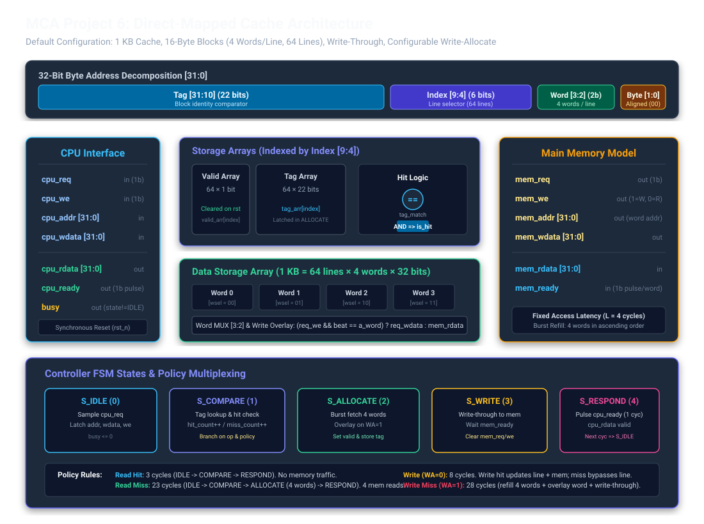
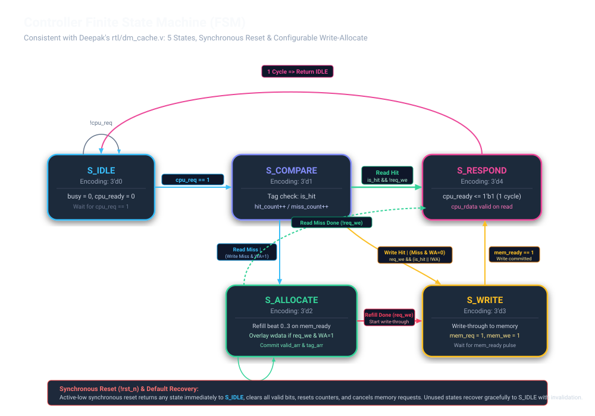

# Cache Architecture and Controller FSM Diagrams

Owner: Meet (Visual Analysis & Performance Lead)

This directory contains architectural and state machine diagrams accurately reflecting Deepak's finalized, verified synthesizable RTL (`rtl/dm_cache.v` and `rtl/main_mem.v`).

---

## 1. Direct-Mapped Cache Datapath Architecture

The architecture diagram illustrates the memory arrays, tag comparator, line indexing, subline word multiplexer, CPU interface, and main memory interconnect.

### 32-Bit Byte Address Decomposition (Default Configuration)
For `CACHE_SIZE = 1024` bytes, `BLOCK_SIZE = 16` bytes (4 words/line):
- **Tag (`[31:10]`, 22 bits)**: Compared against `tag_arr[index]` to determine hit or miss.
- **Index (`[9:4]`, 6 bits)**: Selects one of the 64 cache lines (`NUM_LINES = 1024 / 16 = 64`).
- **Word Select (`[3:2]`, 2 bits)**: Picks one of the 4 words within the line.
- **Byte Offset (`[1:0]`, 2 bits)**: Word-aligned byte offset (always `2'b00`).

### Storage Organization
- **Valid Array**: 64 lines × 1 bit = 64 bits. Reset synchronously to `0` on `!rst_n`.
- **Tag Array**: 64 lines × 22 bits = 1,408 bits.
- **Data Array**: 64 lines × 4 words × 32 bits = 8,192 bits (1 KB).

---

## 2. Controller Finite State Machine (FSM)

The controller operates across 5 primary states with synchronous active-low reset recovery and configurable write allocation.

### State Definitions & Operations

| State | Encoding | Actions Performed | Next State Conditions |
|---|:---:|---|---|
| `S_IDLE` | `3'd0` | `busy = 0`. Listens for `cpu_req`. On request, latches `cpu_addr`, `cpu_wdata`, and `cpu_we`. | `cpu_req == 1` &rarr; `S_COMPARE` `cpu_req == 0` &rarr; `S_IDLE` |
| `S_COMPARE` | `3'd1` | Evaluates `is_hit = line_valid && (tag_arr[index] == a_tag)`. Increments `hit_count` or `miss_count`. | &bull; **Read Hit** (`!req_we && is_hit`) &rarr; `S_RESPOND` &bull; **Write Hit** (`req_we && is_hit`) &rarr; update cache line, launch write-through &rarr; `S_WRITE` &bull; **Write Miss (WA=0)** (`req_we && !is_hit && !WA`) &rarr; launch write-through &rarr; `S_WRITE` &bull; **Read Miss** (`!req_we && !is_hit`) &rarr; start refill &rarr; `S_ALLOCATE` &bull; **Write Miss (WA=1)** (`req_we && !is_hit && WA`) &rarr; start refill &rarr; `S_ALLOCATE` |
| `S_ALLOCATE` | `3'd2` | Fetches 4 words from main memory in ascending address order. Overlays `req_wdata` if `req_we && beat == a_word`. Forwards word to `cpu_rdata` on read miss. On final beat (`beat == 3`), writes tag and sets valid bit. | &bull; `mem_ready && beat < 3` &rarr; `beat++`, `S_ALLOCATE` &bull; `mem_ready && beat == 3 && !req_we` &rarr; `S_RESPOND` &bull; `mem_ready && beat == 3 && req_we` &rarr; `S_WRITE` (write-through) |
| `S_WRITE` | `3'd3` | Holds `mem_req=1, mem_we=1` until memory completes write-through. | `mem_ready == 1` &rarr; `S_RESPOND` |
| `S_RESPOND` | `3'd4` | Pulses `cpu_ready = 1` for exactly 1 cycle. Read data is valid. | Unconditional &rarr; `S_IDLE` |

---

## 3. Allocation Policy Comparison

1. **No-Write-Allocate (`WRITE_ALLOCATE = 0`, Default)**:
   - On a write miss, the cache bypasses allocation (`S_COMPARE` &rarr; `S_WRITE`).
   - Backing memory is updated directly; existing victim lines in the cache are preserved without eviction.
   - Cost: **8 cycles** (at latency 4).
2. **Write-Allocate (`WRITE_ALLOCATE = 1`)**:
   - On a write miss, the entire 16-byte block is refilled into the cache (`S_COMPARE` &rarr; `S_ALLOCATE`).
   - The written word is overlaid onto the incoming memory data during beat reception.
   - Once the block is committed to the cache line, the controller executes a write-through to backing memory (`S_ALLOCATE` &rarr; `S_WRITE`).
   - Cost: **28 cycles** (at latency 4: 3 cycle handshake + 4 words &times; 5 cycles refill + 5 cycles write-through).
