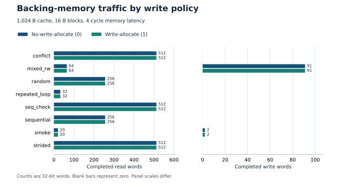
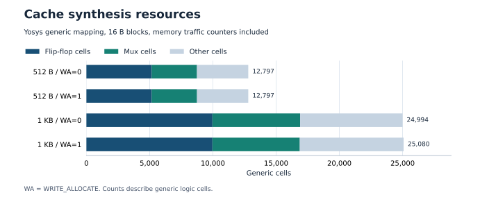

# Phase II memory traffic and synthesis plots

Deepak collected the measurements, Kushagra recorded the regression and deliberate valid-bit fault results, and Meet prepared the figures for Utkarsh's report. [Verification summary](../verification/README.md#3-negative-testing--fault-injection-deliberate-bug-verification)

## Figures for the report



**Traffic takeaway.** Both allocation policies transferred the same number of read words and write words on all eight traces at 1 KB, 16 B blocks, and latency 4. [Traffic figure](plots/plot_memory_traffic.svg) · [Source CSV](memory_traffic.csv)



**Resource takeaway.** The 512 B cache used about half as many generic cells as the 1 KB cache under either write policy. [Resource figure](plots/plot_synthesis_resources.svg) · [Source CSV](../synthesis/traffic_counters/resources.csv)

The resource figure includes the traffic counters and uses generic Yosys cell counts. FPGA utilization and maximum frequency remain unmeasured. [Synthesis notes](../synthesis/README.md)

Regenerate both SVGs from the checked-in CSVs with Python and Matplotlib:

```bash
python3 -m pip install matplotlib
python3 scripts/plot_phase2_results.py
```

## Measurements

[`memory_traffic.csv`](memory_traffic.csv) contains 16 RTL measurements. Each of the eight checked-in traces runs from a fresh reset under both policies at 1 KB, 16 bytes per block, and a four-cycle memory latency. `cpu_reads` and `cpu_writes` count CPU accesses. `mem_reads` and `mem_writes` count completed 32-bit words on the backing-memory interface. `mem_total_words` is their sum.

Both policies produced the same memory read and write totals for every checked-in trace at this configuration. For `mixed_rw.trace`, no-write-allocate performed 16 read-miss refills. Write allocation performed eight read-miss refills and eight write-miss refills. Both moved 64 read words and 91 write words. For `smoke.trace`, both moved 20 read words and two write words. These totals describe this trace set and configuration.

The measurement runner checks read data using the existing trace bench. For each completed trace, it also checks the RTL counters against the observed access classes:

- `mem_reads = (BLOCK_SIZE / 4) * (read_misses + WRITE_ALLOCATE * write_misses)`
- `mem_writes = cpu_writes` under either write-through policy.

The counter values are captured from the RTL. The formulas check the captured numbers. `tb_trace` adds the two fields to its existing schema-version-1 `METRICS` record and preserves its legacy CSV column order.

Run from the repository root with Icarus Verilog and Python:

```bash
python3 scripts/measure_memory_traffic.py --output /tmp/mca-memory-traffic.csv
diff -u docs/results/memory_traffic.csv /tmp/mca-memory-traffic.csv
```

The checked-in CSV passed all 16 data and traffic checks with Icarus Verilog 13.0. A second run at 512 B, 4-byte blocks, and latency 1 passed all 16 checks. An isolated cold write measured 0 reads and 1 write without allocation, and 4 reads and 1 write with allocation at the default geometry. A temporary monitor checked the RTL counters against memory completions through the directed tests under both policies, including reset. [Recorded regression results](../verification/README.md)
