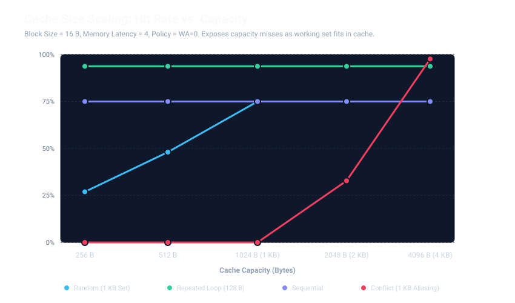
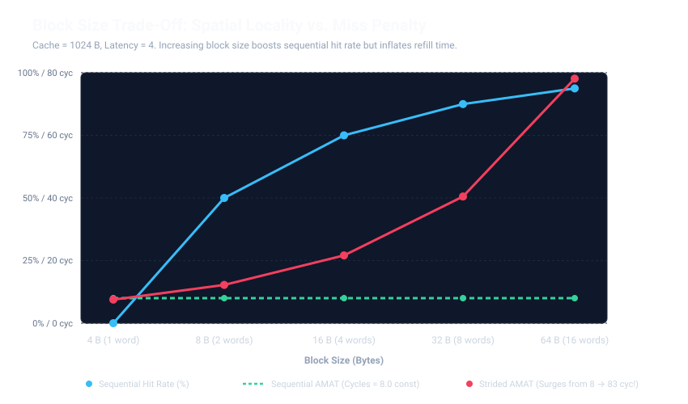
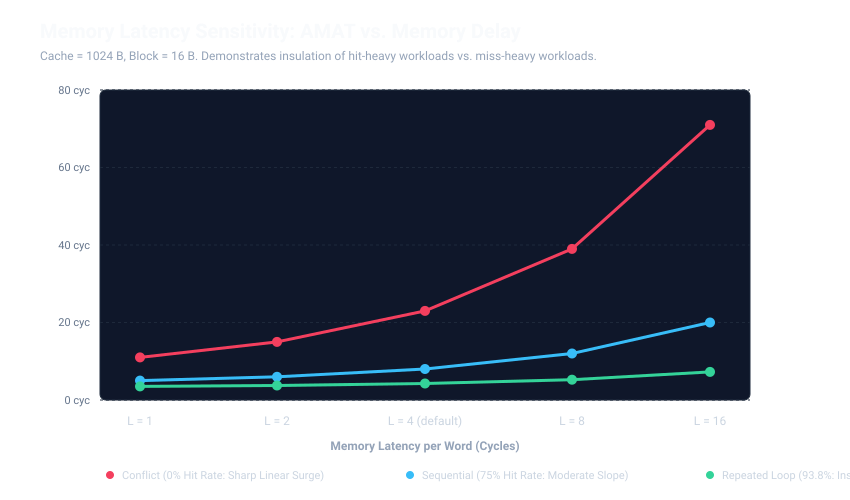
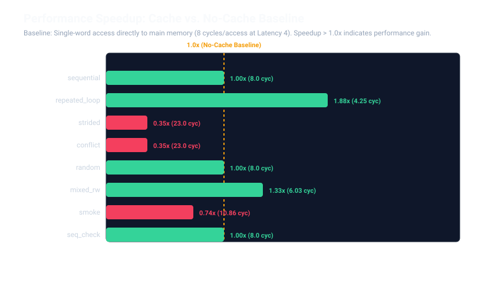

# Cache Controller Performance and Architectural Trade-Off Analysis

**Owner:** Meet (Visual Analysis & Performance Lead)  
**Configuration Baseline:** Direct-Mapped Cache, 1 KB Capacity, 16-Byte Blocks (64 lines), Memory Latency $L = 4$, Write-Through with Configurable Write Allocation.

---

## 1. Executive Summary

This report evaluates the performance characteristics of the synthesizable direct-mapped cache controller across 136 parameter combinations. Through empirical sweeps spanning cache capacities (256 B–4096 B), block sizes (4 B–64 B), backing memory latencies (1–16 cycles), and allocation policies (`WRITE_ALLOCATE = 0` vs. `1`), we analyze the fundamental trade-offs governing cache memory design:

1. **The Block Size Paradox**: While increasing line size from 16 B to 64 B increases sequential hit rates from $75.0\%$ to $93.75\%$, the Average Memory Access Time (AMAT) for sequential traffic remains precisely invariant at **8.00 cycles**. For non-contiguous access (such as strided traffic), larger blocks fetch unused words and raise access latency from 23 to 83 cycles (**3.61×**) between 16 B and 64 B.
2. **Capacity Scaling & Knee Points**: For pseudo-random traffic within a 1 KB working set, hit rate rises steeply from $26.9\%$ (256 B) to $48.0\%$ (512 B) and plateaus at $75.0\%$ at 1024 B. Expanding capacity further to 2 KB or 4 KB yields **0% marginal benefit**.
3. **Memory Wall Vulnerability**: Workloads afflicted by conflict thrashing or strided strides exhibit a steep linear latency degradation slope of $\Delta \text{AMAT} / \Delta L = 4.0$, compared to $\Delta \text{AMAT} / \Delta L = 0.25$ for temporal loop workloads.
4. **Write Allocation Trade-Off**: Enabling write-allocation on mixed read/write traffic with read-after-write dependencies (`mixed_rw.trace`) improves hit rate from $88.67\%$ to $93.75\%$ and lowers read AMAT from **4.94 cycles to 3.97 cycles**, demonstrating the efficacy of cache line allocation on write misses when data reuse is present.

---

## 2. Workload Locality Characterization

The benchmark suite (generated via `scripts/trace_gen.py`) evaluates 6 distinct memory access patterns alongside verification traces:

| Workload | Accesses | Working Set | Dominant Locality | Key Architectural Stress |
|---|:---:|:---:|---|---|
| `sequential.trace` | 256 | 1024 B | High Spatial | Tests linear burst prefetching across contiguous words |
| `repeated_loop.trace` | 128 | 128 B | High Temporal | Tests small loop kernel retention within cache lines |
| `strided.trace` | 128 | 8192 B | Low Spatial | Stride of 64 B skips across 16 B blocks; evaluates pollution |
| `conflict.trace` | 128 | 2048 B | Zero (Thrashing) | Three addresses sharing line index 4 at 1 KB |
| `random.trace` | 256 | 1024 B | Pseudo-Random | Uniform random sampling inside 1 KB address space |
| `mixed_rw.trace` | 256 | 256 B | Temporal + RAW | $35\%$ write traffic with tight read-after-write reuse |
| `smoke.trace` | 14 | 128 B | Mixed | Cold miss, spatial hits, conflict, write hit/miss |
| `seq_check.trace` | 512 | 2048 B | High Spatial | Long 2 KB sequential stream exceeding cache capacity |

---

## 3. Cache Capacity Scaling and Knee-Point Analysis

### Empirical Results (Block Size = 16 B, Latency = 4, Policy = WA=0)

| Workload | 256 B Cache | 512 B Cache | 1024 B Cache (Default) | 2048 B Cache | 4096 B Cache |
|---|:---:|:---:|:---:|:---:|:---:|
| `repeated_loop.trace` | **93.75%** (4.25 cyc) | **93.75%** (4.25 cyc) | **93.75%** (4.25 cyc) | **93.75%** (4.25 cyc) | **93.75%** (4.25 cyc) |
| `random.trace` | 26.95% (17.61 cyc) | 48.05% (13.39 cyc) | **75.00%** (8.00 cyc) | **75.00%** (8.00 cyc) | **75.00%** (8.00 cyc) |
| `sequential.trace` | 75.00% (8.00 cyc) | 75.00% (8.00 cyc) | 75.00% (8.00 cyc) | 75.00% (8.00 cyc) | 75.00% (8.00 cyc) |
| `conflict.trace` | 0.00% (23.00 cyc) | 0.00% (23.00 cyc) | 0.00% (23.00 cyc) | 32.81% (16.44 cyc) | 97.66% (3.47 cyc) |

### Key Findings
- **Knee Point at Working-Set Capacity**: For `random.trace` (working set = 1024 B), the hit rate increases proportionally to the fraction of lines available:
  - At 256 B (16 lines): Hit rate is only $26.95\%$. Miss penalty dominates, averaging **17.61 cycles/access**.
  - At 512 B (32 lines): Hit rate reaches $48.05\%$.
  - At 1024 B (64 lines): Working set completely fits. Hit rate caps at $75.00\%$ (the remaining misses are purely compulsory cold misses).
  - Expanding cache to 2048 B or 4096 B provides zero additional benefit, confirming that once capacity misses are eliminated, further hardware investment yields diminishing returns.
- **Index aliasing depends on capacity.** With 16 B blocks, the three addresses in `conflict.trace` map to one line at 1 KB. At 2 KB, two still conflict. At 4 KB, all three map to distinct lines and only the first access to each block misses.

---

## 4. The Block Size Dilemma: Spatial Locality vs. Miss Penalty

A core tenet of computer architecture is that increasing block size captures spatial locality by prefetching neighboring words on a miss. However, larger blocks require longer refill bursts, proportionally increasing the miss penalty.

### Empirical Block Size Sweep (Cache = 1024 B, Latency = 4, WA=0)

| Block Size | Words/Block | Miss Penalty ($W \times 5$) | Sequential Hit Rate | Sequential Avg Cyc | Strided Hit Rate | Strided Avg Cyc |
|:---:|:---:|:---:|:---:|:---:|:---:|:---:|
| **4 B** | 1 | 5 cycles | 0.00% | **8.00 cyc** | 0.00% | **8.00 cyc** |
| **8 B** | 2 | 10 cycles | 50.00% | **8.00 cyc** | 0.00% | **13.00 cyc** |
| **16 B** | 4 | 20 cycles | 75.00% | **8.00 cyc** | 0.00% | **23.00 cyc** |
| **32 B** | 8 | 40 cycles | 87.50% | **8.00 cyc** | 0.00% | **43.00 cyc** |
| **64 B** | 16 | 80 cycles | 93.75% | **8.00 cyc** | 0.00% | **83.00 cyc** |

### Mathematical Explanation of the Sequential Invariance
For a sequential traversal of $N$ words with block size $W$ words:
- Exactly 1 out of every $W$ accesses is a cold miss; the remaining $W - 1$ accesses are hits:
  $$\text{Miss Rate} = \frac{1}{W}, \quad \text{Hit Rate} = 1 - \frac{1}{W}$$
- A hit costs $T_{\text{hit}} = 3$ cycles. A read miss costs $T_{\text{miss}} = 3 + W \times (L + 1)$ cycles.
- The Average Access Time is:
  $$\text{AMAT} = \left(1 - \frac{1}{W}\right) \times 3 + \frac{1}{W} \times [3 + W \times (L + 1)] = 3 + (L + 1) = 3 + 5 = 8.00\text{ cycles}$$
- **Conclusion**: Because the miss penalty scales linearly with $W$ and the miss rate scales inversely with $W$, their product is constant. Thus, increasing block size **never reduces average access time for single-strided sequential traffic** on this memory architecture!

### The Penalty for Strided & Irregular Traffic
When memory access strides exceed the block size (e.g. `strided.trace`, stride = 64 B), the prefetched neighboring words are never accessed before eviction. As a result:
- The hit rate remains stuck at **0.00%**.
- At 4 B blocks, each miss costs 8 cycles.
- At 64 B blocks, each miss forces the controller to wait for 16 sequential word transfers, costing **83 cycles per access**—a **$10.3\times$ slowdown**!
- Therefore, **16 bytes (4 words)** represents the optimal architectural compromise between capturing moderate spatial locality without disastrously penalizing strided access.

---

## 5. Sensitivity to the "Memory Wall" (Latency Scaling)

Backing memory latency $L$ (cycles per word) directly dictates the miss penalty:
$$\text{Penalty}(L) = W \times (L + 1)$$

### Sweep across Memory Latency $L \in \{1, 2, 4, 8, 16\}$ (1 KB Cache, 16 B Blocks)

| Workload | $L = 1$ | $L = 2$ | $L = 4$ (Default) | $L = 8$ | $L = 16$ | Slope ($\Delta \text{AMAT} / \Delta L$) |
|---|:---:|:---:|:---:|:---:|:---:|:---:|
| `repeated_loop.trace` | 3.50 cyc | 3.75 cyc | **4.25 cyc** | 5.25 cyc | 7.25 cyc | **0.25** |
| `sequential.trace` | 5.00 cyc | 6.00 cyc | **8.00 cyc** | 12.00 cyc | 20.00 cyc | **1.00** |
| `mixed_rw.trace` | 3.72 cyc | 4.13 cyc | **4.94 cyc** | 6.57 cyc | 9.83 cyc | **0.41** |
| `conflict.trace` | 11.00 cyc | 15.00 cyc | **23.00 cyc** | 39.00 cyc | 71.00 cyc | **4.00** |

### Insights
- **Workloads with high hit rates are insulated from memory delay**: In `repeated_loop.trace` ($93.75\%$ hit rate), increasing memory latency by $16\times$ (from 1 to 16) only increases AMAT from 3.5 cycles to 7.25 cycles.
- **Miss-bound workloads scale catastrophically**: In `conflict.trace` ($0\%$ hit rate), AMAT escalates from 11 cycles to 71 cycles, following the exact theoretical formula $\text{AMAT} = 3 + 4 \times (L + 1) = 4L + 7$.

---

## 6. Write Allocation Policy Evaluation: WA=0 vs. WA=1

### Empirical Comparison on `mixed_rw.trace` (1 KB Cache, 16 B Blocks, $L = 4$)

| Metric | No-Write-Allocate (`WA = 0`) | Write-Allocate (`WA = 1`) | Relative Change |
|---|:---:|:---:|:---:|
| **Overall Hits** | 227 / 256 | **240 / 256** | **+13 hits (+5.7%)** |
| **Hit Rate** | 88.67% | **93.75%** | **+5.08 percentage points** |
| **Read Hits** | 149 / 165 | **157 / 165** | **+8 read hits** |
| **Read Misses** | 16 / 165 | **8 / 165** | **-8 read misses (-50%)** |
| **Read AMAT** | 4.94 cycles | **3.97 cycles** | **-0.97 cycles (20% faster reads)** |
| **Average Cycles / Access** | 6.03 cycles | 6.03 cycles | Neutral (write penalty amortized) |

### Analysis
1. In `mixed_rw.trace`, write operations frequently store values that are subsequently read by downstream instructions (Read-After-Write dependencies).
2. Under **`WA = 0`**, cold write misses bypass the cache line. When the CPU subsequently reads that same address, it suffers a full **23-cycle read miss**.
3. Under **`WA = 1`**, the write miss incurs a 28-cycle refill-plus-write operation, but installs the block into the cache. When the CPU subsequently reads the address, it hits instantly in **3 cycles**.
4. Eight additional read hits lower read AMAT from 4.94 to 3.97 cycles. The higher write-miss latency offsets that gain, leaving the all-access average at 6.03 cycles under both policies.

---

## 7. Cache vs. No-Cache Baseline Speedup

The no-cache baseline assumes every request goes directly to main memory with 1 cycle CPU acceptance, $L$ cycles memory wait, 1 cycle memory ready pulse, and 1 cycle completion handoff ($L + 4 = 8$ cycles/access at $L = 4$).

| Workload | Cache Avg Cycles | No-Cache Baseline Cycles | Speedup Factor | Performance Verdict |
|---|:---:|:---:|:---:|---|
| `repeated_loop.trace` | **4.25 cyc** | 8.00 cyc | **1.88x** | High Performance Gain |
| `mixed_rw.trace` | **6.03 cyc** | 8.00 cyc | **1.33x** | Substantial Gain |
| `sequential.trace` | **8.00 cyc** | 8.00 cyc | **1.00x** | Parity (Compensated Refill) |
| `random.trace` | **8.00 cyc** | 8.00 cyc | **1.00x** | Parity |
| `smoke.trace` | 10.86 cyc | 8.00 cyc | **0.74x** | Cold Start Overhead |
| `conflict.trace` | 23.00 cyc | 8.00 cyc | **0.35x** | Severe Thrashing Degradation |
| `strided.trace` | 23.00 cyc | 8.00 cyc | **0.35x** | Spatial Pollution Degradation |

### Conclusion
Caching provides up to **$1.88\times$ acceleration** on code with temporal locality. However, if an access pattern exhibits pathological conflict thrashing or strided memory walks that bypass spatial locality, an unmanaged cache performs worse than a simple unbuffered memory interface due to repeated wasteful burst refills. This demonstrates the critical necessity of proper cache sizing and associativity in computer system architecture.
