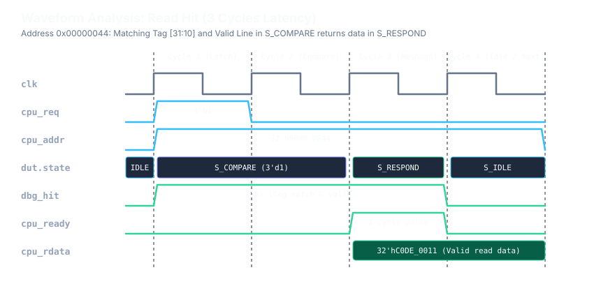
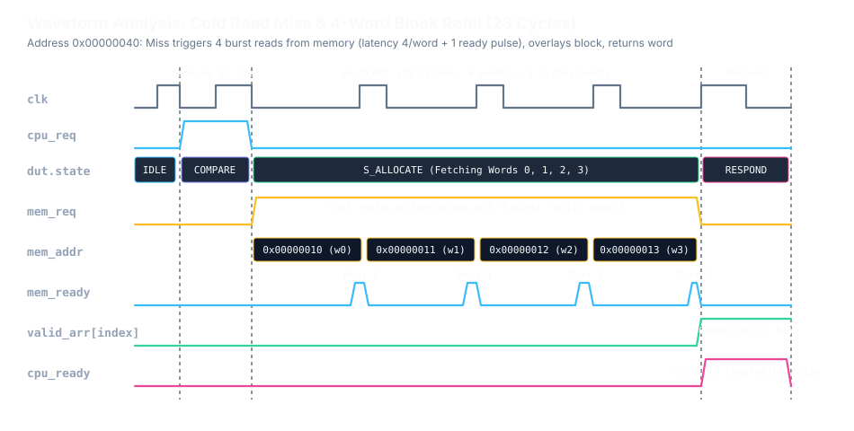

# Waveform Analysis and Timing Walkthrough

Owner: Meet (Visual Analysis & Performance Lead)

This directory provides cycle-accurate waveform analysis and timing breakdowns across all primary controller transaction scenarios, consistent with Deepak's RTL (`rtl/dm_cache.v`, `rtl/main_mem.v`) and verified with `tb/tb_waveforms.v`.

---

## 1. Summary of Measured Latencies (Default: 1 KB Cache, 16 B Blocks, Memory Latency L = 4)

| Scenario | Path Taken | Handshake & Memory Cycles | Total Measured Cost |
|---|---|---|:---:|
| **Read Hit** | `IDLE &rarr; COMPARE &rarr; RESPOND` | 1 accept + 1 compare + 1 respond | **3 cycles** |
| **Read Miss & Refill** | `IDLE &rarr; COMPARE &rarr; ALLOCATE &rarr; RESPOND` | 1 accept + 1 compare + (4 words &times; 5 cyc) + 1 respond | **23 cycles** |
| **Conflict Eviction** | `IDLE &rarr; COMPARE &rarr; ALLOCATE &rarr; RESPOND` | Evicts victim line, refetches new tag into same index | **23 cycles** |
| **Write Hit** | `IDLE &rarr; COMPARE &rarr; WRITE &rarr; RESPOND` | 1 accept + 1 compare + (4 wait + 1 ready) + 1 respond | **8 cycles** |
| **Write Miss (WA=0)** | `IDLE &rarr; COMPARE &rarr; WRITE &rarr; RESPOND` | Bypasses line, writes through to backing memory | **8 cycles** |
| **Write Miss (WA=1)** | `IDLE &rarr; COMPARE &rarr; ALLOCATE &rarr; WRITE &rarr; RESPOND` | Refill 4 words (20 cyc) + write-through (5 cyc) + FSM (3 cyc) | **28 cycles** |
| **Reset Recovery** | Any state &rarr; `IDLE` | Synchronously invalidates valid array & cancels memory bus | **1 cycle** |

---

## 2. Scenario 1: Read Hit (3 Cycles)

A read hit requires zero interaction with main memory. Data is selected directly from `data_arr` using the latched address index and word selector.



### Cycle-by-Cycle Trace
1. **Cycle 1 (`S_IDLE &rarr; S_COMPARE`)**:
   - `cpu_req = 1`, `cpu_we = 0`, `cpu_addr = 0x0000_0044`.
   - On the rising edge of clock, the controller latches address, data, and direction, asserts `busy = 1`, and transitions to `S_COMPARE`.
2. **Cycle 2 (`S_COMPARE &rarr; S_RESPOND`)**:
   - `tag_match = (tag_arr[index] == a_tag)` evaluates to 1 and `line_valid` is 1 &rarr; `is_hit = 1`.
   - `hit_count` increments.
   - The line data for word `2'b01` is placed on `cpu_rdata`. State transitions to `S_RESPOND`.
3. **Cycle 3 (`S_RESPOND &rarr; S_IDLE`)**:
   - Controller pulses `cpu_ready = 1` for exactly one cycle with valid read data.
   - `busy` drops to 0, allowing the next request to be latched on the subsequent clock edge.

---

## 3. Scenario 2: Read Miss and Ascending Block Refill (23 Cycles)

On a read miss, the controller fetches all 4 words of the 16-byte block from memory before acknowledging the CPU.



### Cycle-by-Cycle Breakdown
- **Cycles 1–2 (Accept & Compare)**: Latch request, detect `is_hit = 0`. Increment `miss_count`.
- **Cycle 2**: Initialize burst counter `beat = 0`, compute block start word address `mem_addr = ((req_addr >> 4) << 2)`, assert `mem_req = 1, mem_we = 0`, enter `S_ALLOCATE`.
- **Cycles 3–7 (Beat 0)**: Memory counts 4 wait cycles + 1 ready pulse for word `0x10`. At cycle 7, `mem_ready` pulses; data `0xC0DE0010` is written to `data_arr[index, 0]`. Since requested address was `0x40` (word 0), data is forwarded directly to `cpu_rdata`. `beat` increments to 1, `mem_addr` increments to `0x11`.
- **Cycles 8–12 (Beat 1)**: Memory fetches word `0x11`. At cycle 12, `mem_ready` pulses; data stored in `data_arr[index, 1]`.
- **Cycles 13–17 (Beat 2)**: Memory fetches word `0x12`. At cycle 17, `mem_ready` pulses; data stored in `data_arr[index, 2]`.
- **Cycles 18–22 (Beat 3)**: Memory fetches final word `0x13`. At cycle 22, `mem_ready` pulses; stored in `data_arr[index, 3]`.
  - `beat == WORDS_PER_B - 1`: Controller commits `tag_arr[index] <= a_tag`, asserts `valid_arr[index] <= 1'b1`, deasserts `mem_req <= 0`, and transitions to `S_RESPOND`.
- **Cycle 23 (`S_RESPOND`)**: `cpu_ready` pulses high for 1 cycle with valid read data.

---

## 4. Scenario 3: Conflict Eviction and Replacement

- **Addresses**: Address `0x0000_0040` (Tag `0x00`, Index `0x04`) and Address `0x0000_0440` (Tag `0x01`, Index `0x04`).
- **Mechanism**:
  - Both addresses map to index `0x04` (`NUM_LINES = 64`).
  - Accessing `0x0000_0440` finds line `0x04` valid, but `tag_arr[4] == 0x00 != 0x01`.
  - Result: Conflict miss. Because the cache is write-through, the existing block does not contain dirty data and can be overwritten immediately.
  - The controller executes a 4-word burst refill for tag `0x01`, updates `tag_arr[4] = 0x01`, and sets `valid_arr[4] = 1`.
  - Re-accessing `0x0000_0040` thereafter results in another conflict miss (demonstrating thrashing).

---

## 5. Scenario 4, 5 & 6: Write Policies and Allocation


1. **Write Hit (8 cycles)**:
   - Line is valid and tags match.
   - Controller updates `data_arr[index * 4 + word] <= req_wdata`.
   - Simultaneously asserts `mem_req = 1, mem_we = 1, mem_addr = req_addr >> 2, mem_wdata = req_wdata` and enters `S_WRITE`.
   - Memory takes 5 cycles (4 wait + 1 ready).
   - Once `mem_ready` is observed, state moves to `S_RESPOND`, completing in 8 cycles total.
2. **Write Miss under No-Write-Allocate (`WRITE_ALLOCATE = 0`, 8 cycles)**:
   - Cache bypasses allocation. Line contents and victim tag are left intact.
   - Memory write-through finishes in 5 cycles, completing in 8 cycles total.
3. **Write Miss under Write-Allocate (`WRITE_ALLOCATE = 1`, 28 cycles)**:
   - Triggers full 4-word refill in `S_ALLOCATE` (20 cycles).
   - During refill reception, when `beat == a_word`, the incoming memory word is overwritten with `req_wdata` before writing to `data_arr`.
   - Upon beat 3 completion, tag and valid bits are updated, and the controller transitions to `S_WRITE` to execute write-through to main memory (5 cycles).
   - Total latency: $3 + 4 \times (4 + 1) + 1 \times (4 + 1) = 28$ cycles.

---

## 6. Scenario 7: Mid-Transaction Synchronous Reset Recovery

- Verified via `[6_RESET_MID_REFILL]` in `tb_waveforms.v`.
- If `rst_n` is asserted low while `dut.state == S_ALLOCATE` (mid-refill) or `S_WRITE`:
  - `valid_arr` is instantly wiped to 0 across all lines, preventing partial or corrupt blocks from being tagged valid.
  - `mem_req` and `mem_we` are immediately deasserted, preventing stray memory bus activity.
  - `busy` drops to 0, `state` returns to `S_IDLE`.
  - Backing memory cancels unfinished wait counts and preserves valid initialized memory data.

---

## 7. How to Reproduce Waveforms Locally

Run the waveform generator script to re-compile RTL, execute simulations, and re-create all VCD and SVG diagrams:

```bash
# 1. Run waveform generation script
python3 scripts/generate_waveforms.py

# 2. View waveforms in GTKWave
gtkwave docs/waveforms/cache_scenarios.vcd
```

In GTKWave, inspect these essential signals:
- `tb_waveforms.clk`
- `tb_waveforms.scenario_name`
- `tb_waveforms.cpu_req`
- `tb_waveforms.cpu_we`
- `tb_waveforms.cpu_addr`
- `tb_waveforms.dut.state`
- `tb_waveforms.dbg_hit`
- `tb_waveforms.mem_req`
- `tb_waveforms.mem_we`
- `tb_waveforms.mem_addr`
- `tb_waveforms.mem_ready`
- `tb_waveforms.cpu_ready`
- `tb_waveforms.cpu_rdata`
